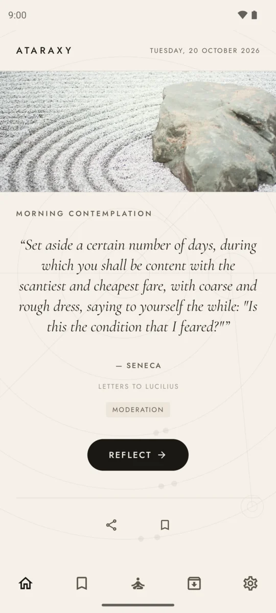
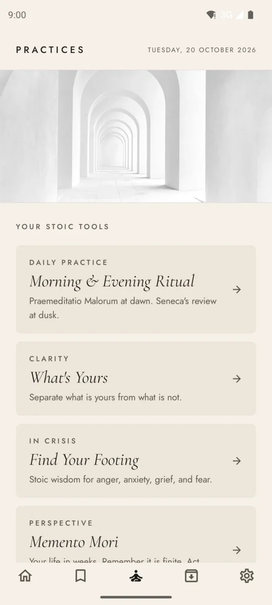
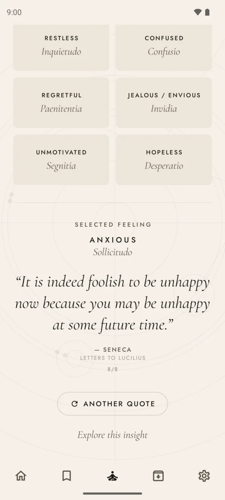

# Ataraxy

**A quiet Android companion for practicing Stoic philosophy.**

Ataraxy (Greek: *ἀταραξία*, "untroubled calm") gives you one Stoic quote each morning, a handful of guided practices drawn from Marcus Aurelius, Epictetus and Seneca, and a private journal to write in. No account, no feed, no network: everything stays on your phone.

<p align="center">
  
  
  
</p>

## Features

### Morning contemplation
A new quote every day from a library of more than 340 passages by Marcus Aurelius, Epictetus, Seneca and Cato the Younger. Each quote is checked against public-domain translations and tagged with one of the four Stoic virtues: wisdom, courage, justice and moderation. Tap **Reflect** to write about it. Each quote also has an **Insight** page on what it means and how to put it into practice.

### Practices
- **Morning & Evening Ritual**: *Praemeditatio malorum* at dawn to rehearse the day ahead, and Seneca's evening review at dusk to look back on it.
- **What's Yours**: a guided reflection on the dichotomy of control. Name what is weighing on you, sort what is yours from what is not, decide what you can still do, and set the rest down.
- **Find Your Footing**: for hard moments. Pick what you are feeling (angry, anxious, grieving, afraid and 20 more) and get Stoic passages chosen for that struggle.
- **Memento Mori**: your life laid out in weeks, as a reminder that time is finite and worth using well.

### Journal and archive
- Every reflection and ritual is saved to a searchable journal you can filter, edit and export as a text file.
- **The Wisdom of Stone** archive lets you browse and search every quote by author, and bookmark the ones you want to keep.

### Made to be calm
- Daily quote, morning and evening reminders, each at a time you choose.
- Light and dark themes, plus larger text sizes for reading.
- Your data stays on the device unless you save a backup somewhere you choose: the app has no internet permission and opts out of cloud backup. See the [privacy policy](https://mpeutz.github.io/ataraxy/privacy/).

## Built with

Kotlin and Jetpack Compose (Material 3), Hilt for dependency injection, Room for the local database, DataStore for preferences, WorkManager for scheduled reminders, and Navigation Compose. Tests run on the JVM with JUnit and Robolectric.

The project has two modules:

- `app`: the Android app (UI, data layer, notifications)
- `core:domain`: plain Kotlin models shared by the app

## Building

Requirements: Android Studio Rabbit (2026.2.1) or newer, JDK 17+, and a device or emulator running Android 10 (API 29) or later.

```bash
./gradlew assembleDebug
```

```bash
./gradlew testDebugUnitTest :app:lintDebug
```

Release builds are signed only when `KEYSTORE_PATH`, `KEYSTORE_PASSWORD`, `KEY_ALIAS` and `KEY_PASSWORD` are set in `local.properties`. Without them, `assembleRelease` produces an unsigned APK.

## License

Copyright © 2026 Mike Peutz. All rights reserved.

The source is public to read, but no license is granted to copy, modify or distribute it. Quotes come from public-domain translations of the original Stoic texts.
